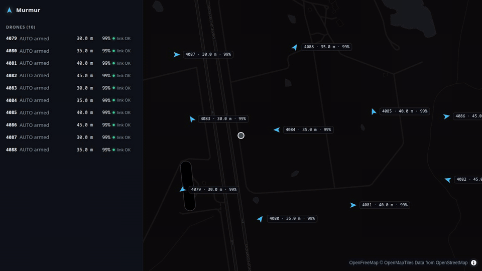
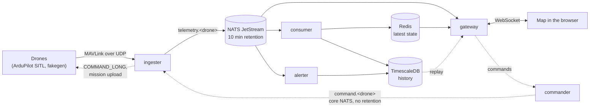
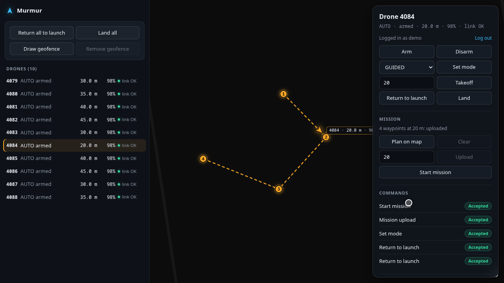
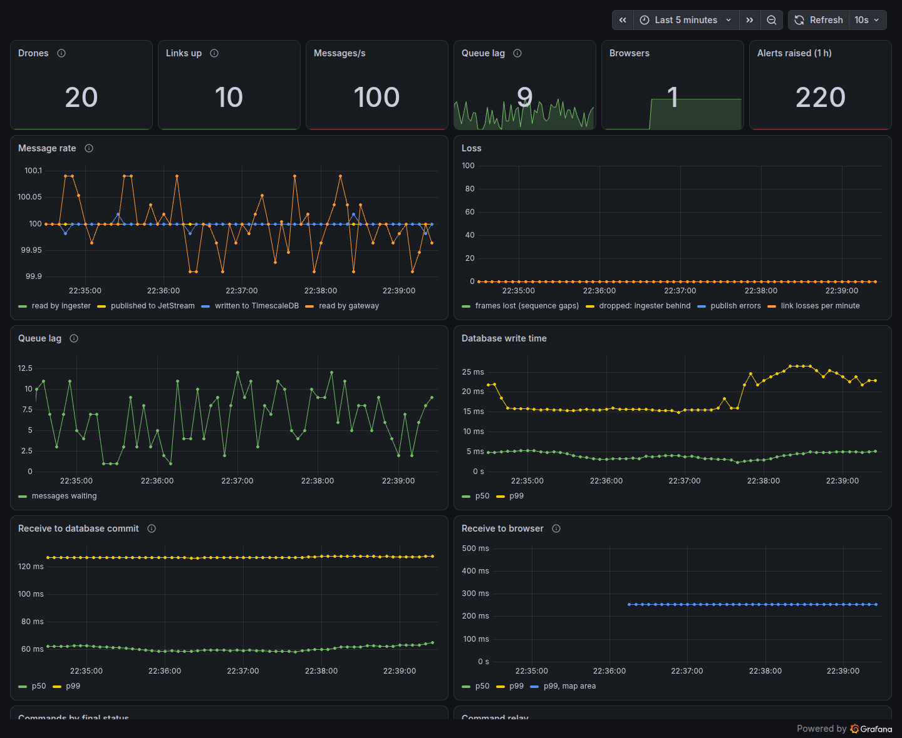

# Murmur

Murmur is a telemetry and command platform for drone fleets that speak MAVLink, the protocol of ArduPilot and PX4. It takes in what each drone sends, stores every message, shows the fleet live on a map, and sends commands and missions back.



It runs on one machine with Docker. It carried **10,000 messages a second from 1,000 drones with no loss**, and passes tests that kill each of its services under load ([results](docs/results.md)).

> **Local only.** MAVLink over UDP has no authentication, and every password in this repository is a local default. Do not expose these ports to a network. Real drones would need an agent on board with an encrypted link, which is not part of this version.

## Quick start

You need Docker with Compose v2. Nothing else: everything builds inside containers.

```sh
git clone https://github.com/ChengCK18/Murmur.git
cd Murmur
./start.sh
```

The first build takes a few minutes. The script waits until the drones are flying, then shows where everything is:

| What | Where | Login |
|---|---|---|
| The map | http://localhost:8080 | `demo` / `murmur`, to send commands |
| Grafana | http://localhost:3000 | none to view; `admin` / `murmur` to edit |
| Prometheus | http://localhost:9090 | none |

Ten simulated drones fly circles, lines and survey patterns near ArduPilot's test field in Canberra. [docs/demo.md](docs/demo.md) is a two-minute tour.

| Command | Does |
|---|---|
| `./start.sh --open` | starts it and opens the map |
| `./start.sh --sitl` | adds three real ArduCopter instances from [ArduPilot's simulator](https://ardupilot.org/dev/docs/sitl-simulator-software-in-the-loop.html); the first build compiles ArduPilot, about 5 minutes |
| `./start.sh status` | what is running, and how many drones are live |
| `./start.sh logs [service]` | follows the logs |
| `./start.sh stop` | stops everything and keeps the data |

The script is a wrapper around `docker compose -f deploy/docker-compose.yml`. To delete the stored data as well: `docker compose -f deploy/docker-compose.yml --profile sitl down -v`.

## Architecture



| Service | Job |
|---|---|
| `cmd/ingester` | Owns the UDP socket. Decodes MAVLink, gives each drone an ID that survives a restart, counts lost packets, publishes every message, and relays commands back from the same socket. |
| `cmd/consumer` | Writes telemetry to TimescaleDB and each drone's latest state to Redis. It acknowledges only after both, so a restart loses and duplicates nothing. |
| `cmd/gateway` | Serves the map, a WebSocket of live state limited to what each browser is looking at, flight history for replay, and the demo login. |
| `cmd/commander` | Owns each command from request to result: checks, audit log, retries, matching the drone's answer, and the mission upload handshake. |
| `cmd/alerter` | Raises and clears low battery, link lost and geofence alerts, with its own consumer so it never slows the database writes. |
| `cmd/fakegen` | Simulated drones: up to thousands, each with its own UDP port, answering commands as ArduPilot does. |

Two rules shape the design:

- **Telemetry is never lost.** JetStream keeps ten minutes of messages, so a consumer or database outage shorter than that loses nothing. A unique key in the database drops the copies a restart redelivers.
- **Commands never run late.** A command that cannot be delivered now fails visibly. Commands expire after 5 seconds and travel on core NATS, which keeps nothing, so a "take off" sent while the ingester is down cannot fire when it comes back.

## What it does



- **Live map:** every drone turned to its heading with altitude and battery, greyed out when its link is lost. The browser follows only what is on screen, so a big fleet does not flood it.
- **Commands:** arm, disarm, set mode, take off, return to launch and land, each with a status from pending to accepted, rejected, timed out or unreachable. Arm and takeoff ask for confirmation.
- **Fleet commands:** "Return all to launch" goes to every drone at once, with totals and the failures listed drone by drone.
- **Missions:** click waypoints on the map, upload them, and start the mission.
- **Alerts:** low battery, link lost and leaving a geofence drawn on the map. Each is stored, and shown in every open browser.
- **Replay:** any drone's stored flight played back with a time scrubber.
- **Dashboards:** Grafana shows the pipeline (rates, loss, queue lag and latency) and the fleet (messages stored, alerts and commands).



## Results

On one desktop (Intel Core i5-8400, 6 cores), with the load generator on the same machine:

| Measure | Result |
|---|---|
| Throughput, held for 5 minutes | 10,000 messages a second from 1,000 drones |
| Packets lost | 0 |
| Receive to database commit, p50 / p99 | 184 ms / 502 ms |
| Receive to browser, p50 / p99 | 129 ms / 254 ms |
| Where it stops | The consumer, at 13,000 to 14,000 rows a second |
| A command to 20 drones losing and rejecting some | A final status for every drone in 1.6 s |

The full write-up, with charts, the two bottlenecks found and fixed, and the failure tests, is in [docs/results.md](docs/results.md).

## Development

You need Go 1.25 and Node.js 24 for work outside containers.

```sh
make infra      # NATS, TimescaleDB and Redis only
make test       # Go unit tests
make web-test   # the web app's type check and unit tests
make itest      # integration tests with the real binaries; SITL tests run if ArduPilot is in ~/ardupilot
make up         # the whole stack
make e2e        # browser tests in Chrome and Firefox, against the running stack
make failures   # kills each service under load and checks the limits (about 10 minutes)
```

The browser tests need Google Chrome installed and Playwright's Firefox (`cd web && npx playwright install firefox`). `cd web && npm run record` re-records the GIF and screenshots in this README from the running stack; it needs ffmpeg.

| Directory | What is in it |
|---|---|
| `cmd/` | The six services |
| `internal/` | Shared packages: MAVLink decoding, drone IDs, loss counting, the NATS messages, commands and alerts |
| `migrations/` | The database schema, applied by the services at start |
| `web/` | The map: React, TypeScript and MapLibre |
| `deploy/` | Docker Compose, the SITL image, Prometheus and Grafana |
| `loadtest/` | The load and failure tests, and their recorded results |
| `testdata/` | MAVLink recorded from ArduPilot's simulator, used by the unit tests |

[CHANGELOG.md](CHANGELOG.md) lists every change.

## Licence

[MIT](LICENSE). The SITL image builds [ArduPilot](https://github.com/ArduPilot/ardupilot), which is GPLv3, from its own repository; none of its code is in this one. Map tiles are from [OpenFreeMap](https://openfreemap.org), with data © OpenStreetMap contributors.
